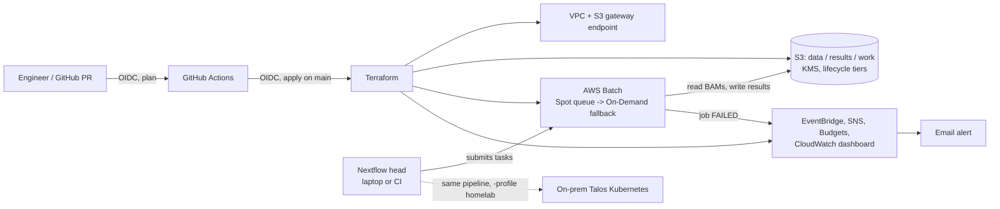

# Genomics Platform on AWS

A small, production-shaped platform for running genomic pipelines on AWS: Terraform-managed
infrastructure, Nextflow on AWS Batch with Spot capacity, encrypted tiered storage, GitHub
Actions CI/CD with OIDC (no stored AWS keys), alerting and cost guardrails. The same pipeline
also runs on an on-prem Kubernetes cluster, so the repo covers both cloud and hybrid work.

It idles at close to zero cost: compute scales to zero and there is no NAT gateway.



## What this demonstrates

| Platform skill | Where it is in the repo |
|---|---|
| AWS compute, storage, networking, security | `infra/modules/*`: VPC, Batch on EC2 Spot, S3 + KMS, IAM least privilege, IMDSv2, SSM instead of SSH |
| Terraform for repeatable, secure builds | Reusable modules, remote state with S3-native locking, `fmt`/`validate`/`tflint`/`checkov` in CI |
| CI/CD and release automation | `.github/workflows/`: plan on PR (posted as a comment), gated apply on `main`, nf-test for the pipeline |
| Monitoring, logging, alerting | Failed-job emails via EventBridge -> SNS, job log retention, dashboard, Nextflow trace/report per run |
| High-throughput and HPC-style workloads | Nextflow on AWS Batch, Spot with automatic retry and On-Demand fallback, `max_vcpus` ceiling |
| Hybrid / on-prem | `-profile homelab` runs the same pipeline on Kubernetes |
| Cost optimisation | Spot, scale to zero, no NAT, S3 gateway endpoint, lifecycle tiering, Bucket Keys, AWS Budget alerts |
| Documentation | Architecture decisions in `docs/adr/`, operations in `docs/runbook.md` |

## Repository layout

```
infra/
  bootstrap/        one-off: state bucket, GitHub OIDC provider, CI plan/apply roles
  modules/
    network/        VPC, subnets, S3 gateway endpoint, optional NAT, compute security group
    storage/        data / results / work buckets, KMS key, lifecycle rules, TLS-only policies
    batch/          instance role and profile, launch template, Spot + On-Demand environments, queues
    observability/  SNS alerts, EventBridge rules, AWS Budget, CloudWatch dashboard
  envs/dev/         the deployable stack that wires the modules together
pipelines/bam-qc/   Nextflow pipeline: flagstat vs idxstats mapped-read concordance, with nf-test
docs/               roadmap, ADRs, runbook
```

## Getting started

Prerequisites: an AWS account you control (a fresh one is best), AWS CLI v2, Terraform >= 1.10,
Docker, Java 17, Nextflow >= 24.04, nf-test, and a GitHub repository for this code.

```bash
# 0. Run the pipeline locally first. No AWS needed.
make run-local

# 1. One-off bootstrap with admin credentials
make bootstrap GITHUB_REPO=your-user/genomics-platform-aws
terraform -chdir=infra/bootstrap output

# 2. Configure the dev stack
cp infra/envs/dev/backend.hcl.example infra/envs/dev/backend.hcl          # set the state bucket
cp infra/envs/dev/terraform.tfvars.example infra/envs/dev/terraform.tfvars # set repo and email
make init plan apply
# Confirm the SNS subscription email AWS sends you.

# 3. Run on AWS Batch
make upload-test-data
make run-aws

# 4. Stop all charges when you are done
make destroy
```

To let CI deploy, add these in GitHub. Secrets: `AWS_PLAN_ROLE_ARN`, `AWS_APPLY_ROLE_ARN`.
Variables: `TF_STATE_BUCKET`, `ALERT_EMAIL`. Then create a `dev` environment with yourself as a
required reviewer.

## Cost

Idle, the platform costs about $1 a month for the KMS key, plus a few pennies of S3 storage.
Batch has no charge of its own, and compute scales to zero. A test run uses minutes of Spot
capacity, which costs cents. The budget alert defaults to $20 a month.
Run `make costs` to see month-to-date spend by service.

Setting `enable_nat = true` adds a NAT gateway at about $35 a month.
See [ADR 0002](docs/adr/0002-no-nat-gateway.md).

## Status

See [docs/ROADMAP.md](docs/ROADMAP.md) for milestones. Record real run numbers here as you
complete them: runtime, cost per run and Spot interruptions handled.
